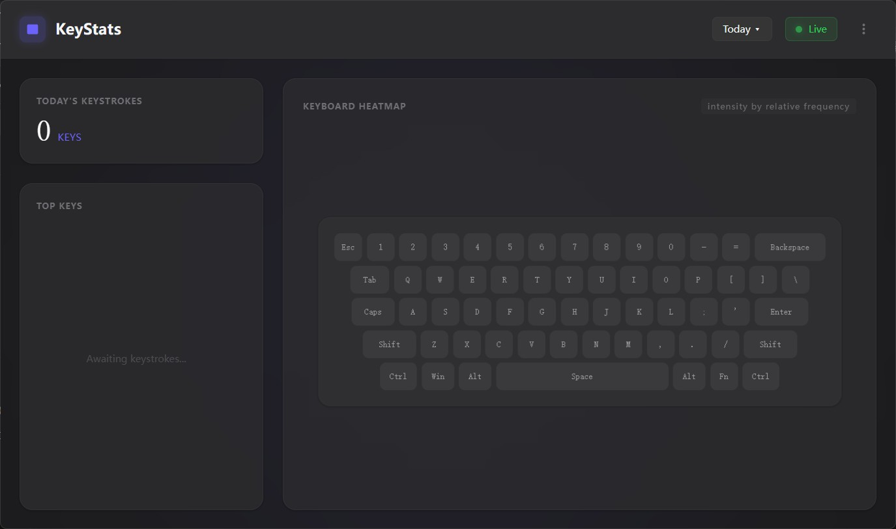

# KeyStats

Real-time keyboard usage tracker for Windows — lightweight native C11 + Direct2D/DirectComposition desktop app with **zero WebView2 / runtime dependencies** (~1.2 MB single executable).



## Features

- **Ultra-lightweight native binary** — pure C11 core + DirectComposition / Direct2D 1.1 UI (~1.2 MB standalone `.exe`, zero Edge WebView2 requirement, instant cold start, 0% idle CPU)
- **Global keystroke capture** — low-level Windows hook (`WH_KEYBOARD_LL`), works across all apps without blocking typing
- **Live key highlight** — mirrors physical key presses onto the 6-row QWERTY heatmap with `<1 ms` event-driven wakeup, L/R modifier side detection, and 180 ms visual flash
- **Seamless borderless native UI** — `WS_EX_NOREDIRECTIONBITMAP` DirectComposition chrome with zero outer non-client border, hardware `CLSID_D2D1GaussianBlur` frosted glass menus/modals, 0.35s animated Dark/Light/Auto transitions, 5 color schemes (`indigo`, `ocean`, `emerald`, `amber`, `rose`), and crisp emoji-free DirectWrite typography
- **Continuous cumulative dashboard** — cumulative total keystrokes, top apps, top keys ranking, and interactive QWERTY heatmap recorded continuously into local SQLite while running (no calendar/date cutoffs)
- **Persistent geometry & safe reset** — saves dragged window size (including compact 4:3 aspect ratios down to `780x540`) and monitor-clamped position across restarts, with two-step red danger confirmation in Settings to permanently clear stats
- **Instant searchable font picker** — virtualized DirectWrite font list with live font preview and native Windows IME search support
- **Bilingual UI (EN / 中文)** — follows system locale (`auto`) or switches manually between English and Chinese (including tray menu)
- **System tray & single instance** — Show Window, Pause/Resume Recording, Launch on Startup toggle, Reset Layout & Settings (preserving statistics), and Quit from tray; re-launching focuses the existing window
- **Zero-config & portable storage** — SQLite with WAL mode & 15-minute rollup buckets at `%APPDATA%/key-stats/data.db`, or portable next to the executable when `.env` is placed alongside it

## Tech Stack

| Layer | Technology |
|-------|------------|
| Window & OS | Native Win32 API + `PerMonitorV2` DPI |
| Rendering | Direct3D 11 + DXGI Composition + DirectComposition + Direct2D 1.1 (`CLSID_D2D1GaussianBlur`) + DirectWrite |
| Core & Hook | Pure C11 (`-Wall -Wextra -Werror`) + `WH_KEYBOARD_LL` + `Shell_NotifyIconW` |
| Database | SQLite 3 amalgamation (WAL mode, 15m rollups, async batch writer) |

## Build & Test

### Prerequisites

- Windows 10 / 11
- MSYS2 MinGW-w64 (`gcc`, `g++`, `windres`)

### Build & Run Unit Tests

```powershell
# Full clean build + run core and UI unit tests -> build\bin\key-stats.exe
powershell -ExecutionPolicy Bypass -File scripts\build.ps1 -Clean -RunTests
```

### Run

```powershell
.\build\bin\key-stats.exe
```

## Releases

GitHub Actions builds a stripped native `key-stats.exe` and runs all unit tests automatically on `v*` tag pushes via `.github/workflows/release.yml`.
